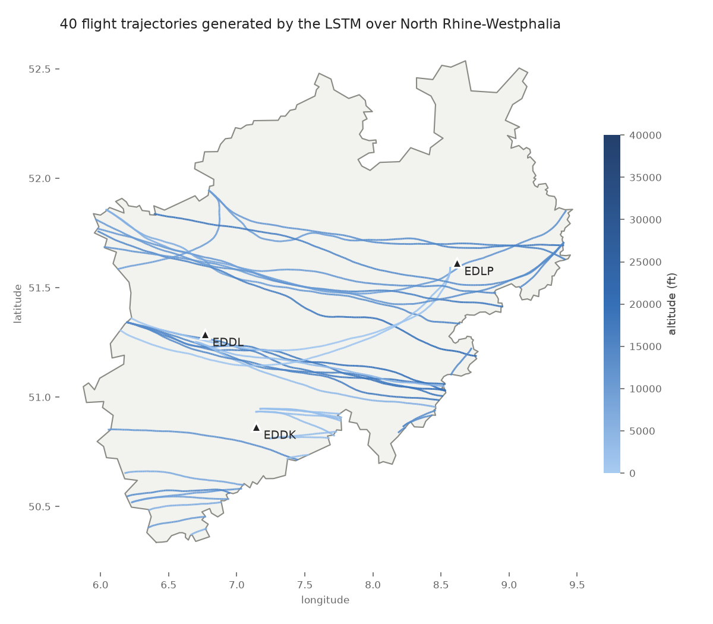

# LSTM Flight Trajectory Generator

An autoregressive LSTM that learns how aircraft move from real flight tracks, then generates any number of new, realistic synthetic trajectories (position, altitude, ground speed, heading and timing) inside a given region.



*40 trajectories generated by the trained model. Line colour shows altitude, and the triangles mark the airports used as end points.*

Developed during a research internship at TU Berlin (2025).

## The problem

Real trajectory datasets are usually small, incomplete or restricted, while testing systems that store and query moving objects needs large volumes of realistic data. Random walks or straight lines between two points do not reproduce real traffic: aircraft turn, climb and descend, keep plausible speeds, enter and leave a region at its border, and land at airports.

This project learns those dynamics from a limited set of real flights and samples new trajectories from the trained model:

- each new trajectory follows the statistics of real traffic without copying any real flight;
- the output size is unbounded;
- generation enforces geographic constraints.

## Features

- **Full pipeline**: raw point CSV → per-flight files → balanced training subset → tensors → trained model → generated trajectories → interactive map.
- **Rich motion model**: 7 features per time step cover displacement, altitude, time step, ground speed and heading.
- **Geographic constraints during generation**: a trajectory stops when it leaves the region polygon or reaches an airport, so trajectories start and end at plausible places.
- **Parallel generation**: a multi-process generator resumes from existing output and targets 1,000,000 trajectories by default.
- **Balanced training set**: flights are classified as straight or turning, so the model does not learn to fly straight only.
- **Map visualisation**: generated or real flights are drawn on a Leaflet map with Folium, and each point has a timestamp.

## Model

`FlightLSTM` (`model/model.py`) predicts the next step of a flight from the steps before it.

| | |
|---|---|
| Input | sequence of 7-dimensional steps, normalised with dataset mean/std |
| Encoder | 3 stacked LSTM layers, hidden size 256, dropout 0.3 |
| Head | dropout + linear layer 256 → 7 |
| Output | the predicted next step (same 7 features) for every position of the sequence |

Features per step (`process_data/preprocess_to_tensor.py`):

| Feature | Meaning |
|---|---|
| `dlat_m`, `dlon_m` | north / east displacement since the previous point, in metres |
| `dalt` | altitude change (ft) |
| `dtime` | time since the previous point (s) |
| `gs_kt` | ground speed (knots) |
| `heading_sin`, `heading_cos` | heading encoded as sine/cosine, to avoid the 359° → 0° jump |

Training (`model/train.py`) uses:

- a Smooth-L1 loss, masked on padding and weighted per feature (displacement and heading weigh the most);
- Gaussian input noise and scheduled sampling: about 10% of the batches are fed the model's own predictions, which limits drift when the model generates on its own;
- AdamW, a cosine-annealing learning rate and gradient clipping;
- early stopping on a 10% validation split, which keeps the best checkpoint in `best_lstm.pt`.

## Generation

`generate_traj.py` (sequential) and `generate_parallele_traj.py` (multi-process) build each trajectory as follows:

1. **Start point**: the first point of a random real flight from `flights_txt/`. When that folder is empty, `generate_traj.py` starts from a random point on the region border at a random cruising altitude.
2. **Seed**: two initial steps point toward the centre of the region.
3. **Autoregressive rollout**: the model predicts the next step and a small amount of Gaussian noise is added for diversity. Displacements are then integrated back into latitude/longitude.
4. **Stopping rules**:
   - the trajectory is more than 100 m outside the region polygon (KD-tree on the border + point-in-polygon test, `geo_utils.py`);
   - it comes within 1.5 km of an airport;
   - it reaches 300 steps.
5. **Filtering**: trajectories with fewer than 5 points are discarded.

The parallel version spreads this loop over worker processes (`--workers N`), numbers the output files through a shared counter, and continues from the highest ID already present in `generated/`.

## Pipeline

```
flights CSV ──► process_data.py ──► flights_txt/*.txt          one file per flight, speed + heading derived
                split_dataset.py ──► flights_txt_for_training/  balanced straight / turning subset
         preprocess_to_tensor.py ──► dataset/tensors/*.pt, dataset/stats.json
                        train.py ──► best_lstm.pt
generate_traj.py / generate_parallele_traj.py ──► generated/*.txt
                 display_on_map.py ──► generated/flights_map.html
```

## Getting started

### Install

```bash
python3 -m venv .venv
source .venv/bin/activate
pip install -r requirements.txt
# a CPU-only PyTorch build is enough:
# pip install --index-url https://download.pytorch.org/whl/cpu torch
```

All paths are resolved relative to the repository root, so the scripts can be launched from any directory.

### Input data

No data and no trained weights are included. The original model was trained on non-public flight data, so you need to provide your own flights, for example ADS-B data from the [OpenSky Network](https://opensky-network.org/) converted to the format below.

`process_data/process_data.py` reads a **semicolon-separated CSV without a header**, with one point per line:

| # | Column | Example | Notes |
|---|---|---|---|
| 1 | `track_id` | `1001` | flight identifier, used to group points |
| 2 | `ac_type` | `A320` | not used by the model |
| 3 | `origin` | `ABCD` | not used by the model |
| 4 | `dest` | `WXYZ` | not used by the model |
| 5 | `point` | `POINT(7.10 51.20)` | WKT point, **longitude first** |
| 6 | `ts` | `2024-05-01 12:00:00` | `YYYY-MM-DD HH:MM:SS` |
| 7 | `alt_ft` | `11000.0` | altitude in feet |

```
1001;A320;ABCD;WXYZ;POINT(7.10 51.20);2024-05-01 12:00:00;11000.0
1001;A320;ABCD;WXYZ;POINT(7.12 51.19);2024-05-01 12:00:05;11050.0
```

### Region

`region_border.geojson` is an example region: a polygon around North Rhine-Westphalia (Germany), drawn by hand. To generate trajectories elsewhere:

- replace it with any GeoJSON polygon;
- update the `AIRPORTS` and `CENTER_LAT, CENTER_LON` constants at the top of the generation scripts.

### Run

```bash
python process_data/process_data.py path/to/flights.csv   # -> flights_txt/
python process_data/split_dataset.py                       # -> flights_txt_for_training/
python process_data/preprocess_to_tensor.py                # -> dataset/tensors/, dataset/stats.json
python model/train.py                                      # -> best_lstm.pt (CUDA if available)

python generate_traj.py                                    # -> generated/generated_flight_XXX.txt
python generate_parallele_traj.py --workers 4              # parallel, large-scale generation
python display_on_map.py                                   # -> generated/flights_map.html
python display_raw_on_map.py                               # map of the real input flights
```

Each script has its settings as constants at the top: number of trajectories, maximum length, straight/turning mix, hyperparameters. `split_dataset.py` expects at least 8,500 straight and 17,000 turning flights by default, so lower `N_STRAIGHT` and `N_TURN` for small datasets.

### Output

Each generated trajectory is a CSV file:

```
lat,lon,alt_ft,delta_t_s,gs_kt,heading_deg
```

## Tech stack

Python, PyTorch, NumPy, pandas, SciPy (KD-tree), Shapely, Folium, tqdm.

## Author

Arthur Dufetrelle

## License

[MIT](LICENSE)
